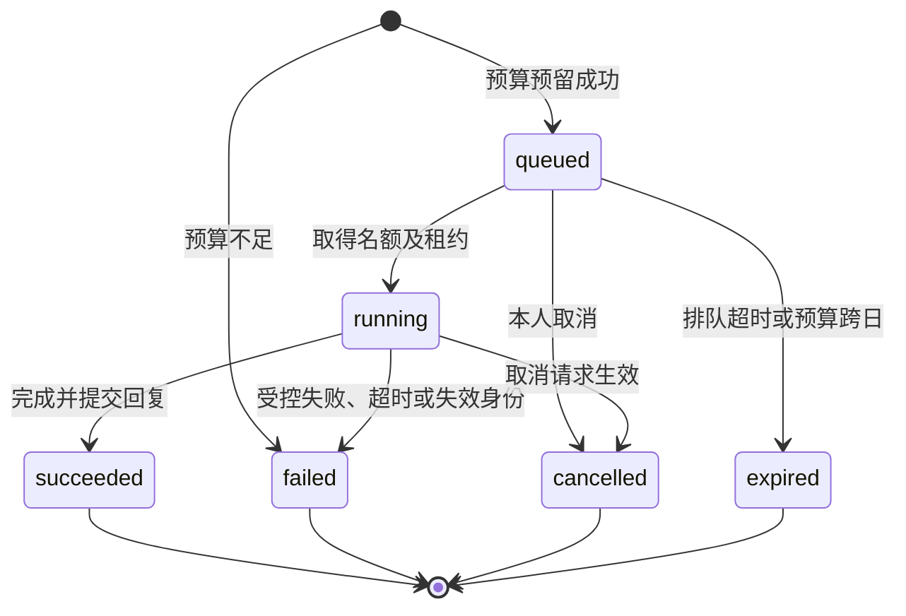
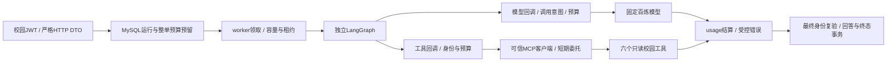

# 第七步 M3：会话、运行与预算接口

M3 在 M1 模型适配、M2 私有只读 MCP 工具之上增加会话与运行资源、持久调度状态、成本预留账本及站内告警。用户确认的演示策略为：单运行 0.10 元、单用户每日 1 元、全局每日 5 元、80% 告警、会话正文保留 7 天。真实云验收授权仅限合成对话与模拟工具结果，最多 10 次请求、合计不超过 5 元；正式校园数据外发保持关闭。

所有接口位于 `/api/assistant`，使用既有校园 Bearer JWT。学生、教师和管理员均只能访问自己的会话、消息与运行；管理员额外查看全局预算数字与全局运营告警。权限来自服务端当前身份，不接受请求体中的 owner_id、role、模型、密钥、调用地址、价格或成本限额。

## 模块边界

| 模块 | 稳定职责与调用方向 |
| --- | --- |
| `app/assistant/conversations.py` | 会话 CRUD、本人范围、归档/删除/过期、成功对话上下文、正文清理；不调用模型或工具 |
| `app/assistant/runs.py` | 运行入队、幂等、并发名额、执行租约、取消/重试与终态持久化；调用会话及预算服务 |
| `app/assistant/budget.py` | Decimal 预留、调用意图、用量结算、不确定消费、额度快照和去重告警；不调用外部服务 |
| `app/assistant/executor.py` | 预算与身份保护下的模型/MCP 回调、超时、受限重试、取消及最终结算；注入 provider/tool client |
| `app/assistant/graph.py` | 每运行独立 LangGraph，模型→有界并发只读工具→模型；严格工具参数与可信引用 |
| `app/assistant/providers.py` | 固定百炼适配、发送前费用上界、原始 HTTP usage 检查、正文/思考/日志保护 |
| `app/assistant/worker.py` | MySQL 持久队列领取、租约心跳、孤儿恢复及正文清理；维护模式不需要模型/MCP配置 |
| `app/api/assistant.py` | 严格 HTTP 参数、校园鉴权、白名单响应；不把 ORM 对象、源会话信息或租约序列化给客户端 |
| `app/assistant/settings.py` | 独立策略加载；无模型密钥、资源创建或导入时网络调用 |
| `app/models/assistant.py`、`0006_assistant.py` | 会话、消息、运行、调用用量、日预算、告警及调度控制表；结构通过新迁移管理 |

共享数据库事务只保护短期状态变更与预算记账，模型、工具和等待退避发生在事务之外。助手写入统一先取得调度控制行，再复验当前用户与会话/运行；外部账号状态变化不依赖客户端缓存。业务服务、成本账本和 HTTP 投影分开，后续可替换执行器、追加模型或告警展示而不改变公开会话格式。

## 接口清单

成功正文沿用 `{"code":200,"message":"请求成功","data":...}`。创建会话的 HTTP 状态为 201，提交/重试运行为 202，其余成功状态为 200。响应使用 `Cache-Control: private, no-store`。所有日期时间返回 UTC ISO 8601；每日预算窗口使用北京时间，金额为 CNY 十进制字符串。

| 方法及路径 | 请求 | 返回与约束 |
| --- | --- | --- |
| `POST /conversations` | `{"title":"新会话"}`，title 可省略，1–100 字符 | 新会话；服务器生成 UUID、owner、期限和消息序号 |
| `GET /conversations` | page 默认 1、page_size 默认 20，最大 100 | 本人列表，按创建 ID 倒序；已删除资源不再列出 |
| `GET /conversations/{id}` | UUID 路径 | 本人会话状态；过期后不返回原标题 |
| `PATCH /conversations/{id}` | 非空的 title 和/或 state；state 仅 active/archived | 重命名或归档/恢复；有活动运行时 409，过期资源不能恢复 |
| `DELETE /conversations/{id}` | UUID 路径 | 软删除并擦除消息正文、引用与标题；有活动运行时 409；重复删除同一本人资源可成功 |
| `GET /conversations/{id}/messages` | page、page_size | 按 sequence 升序的消息，包括失败运行的用户输入；到期正文为 null、引用为空、redacted=true |
| `POST /conversations/{id}/runs` | content（1–4000 字符）、request_key（ASCII 1–64） | 持久运行资源；同一会话同时只允许一个未完成运行 |
| `GET /conversations/{id}/runs` | page、page_size | 本人运行列表，最近创建的在前 |
| `GET /runs/{id}` | UUID 路径 | 状态、计数、预算及调用用量；未知 Token 保留 null |
| `POST /runs/{id}/cancel` | 无正文 | 排队任务立即取消；正在执行的任务持久标记取消，由执行器在等待/边界检查中停止 |
| `POST /runs/{id}/retry` | 新 request_key | 为本人 failed/cancelled/expired 运行创建新资源，复用尚未到期的原问题，使用当前登录与重新预留的预算 |
| `GET /budget` | 无正文 | 本日个人 cap/spent/reserved/available 和策略；管理员额外取得 global 数字 |
| `GET /alerts` | page、page_size | 本人告警；管理员额外取得 owner 为空的全局告警 |
| `POST /alerts/{id}/ack` | 正整数告警 ID | 将本人或有权访问的全局告警标为已读；不解除预算限制 |

所有请求体拒绝额外字段及隐式类型转换。分页参数允许第 1–1000 页。不存在与跨用户访问统一返回 404；失效校园身份为 401；当前会话已有运行、幂等键冲突或状态不允许操作为 409；过期正文无法重试为 410；参数无效为 422；队列/提交频率受限为 429；运行未启用、数据外发未批准、配置无效或存储不可用为受控 503。

开启运行须同时满足 `enabled` 和 `allow_campus_data`；默认均为 false。会话管理和额度查询可独立使用。预算不足时提交仍创建一个可查询的终态资源，HTTP 202，`status=failed`、`reason=budget_exceeded`，不派发外部请求。这样客户端可以统一围绕运行 ID 展示结果与原因，而不把“资源已创建”误解为“模型已执行”。

## 会话及上下文

会话公开字段为 id、title、state、active_run_id、created_at、updated_at、expires_at。state 为 active、archived、deleted 或 expired；删除资源对后续读取表现为 404。

消息公开字段为 id、sequence、run_id、role、content、citations、redacted、created_at。role 仅 user/assistant。每个会话使用服务端递增序号，用户不能指定消息角色、历史、工具结果或系统提示。

模型上下文仅选择已成功运行的完整 user/assistant 对，按会话序号排序。失败、取消、尚未执行、缺失一侧及过期的消息不进入上下文。默认最多 8 轮、48,000 UTF-8 字节；超过容量从最旧的完整对开始移除，不截成孤立的用户或助手消息。当前待执行输入由运行执行器另行追加，不混入历史选择。

每条消息以自身创建时间计算 7 天期限；保持会话活跃不会使旧正文无限延期。读取时即时脱敏，后台维护分批擦除正文及引用。过期会话标题亦被擦除；软删除立即擦除该会话全部正文。删除和清理保留最小财务计数及调度状态，不保留原始工具响应、模型思考或原校园 JWT。

## 运行状态、幂等与控制



公开运行字段包括 id、conversation_id、status、reason、cancel_requested、model_calls、tool_calls、cost_limit、reserved、spent、budget_day、created_at、started_at、finished_at、deadline_at。调用明细还包含 kind、resource、attempt、state、reserved、charged、input_tokens、output_tokens、cache_read_tokens、usage_unknown、price_version、latency_ms。原会话 jti/期限、权限版本、内部主键、请求哈希和执行租约令牌不会返回给客户端。

`request_key` 仅允许字母、数字、下划线及连字符；同一会话内唯一。相同键及相同问题/重试来源返回原运行，同键不同内容返回 409。失败后的人工重试生成新运行和新费用记录，不复活原租约。当前会话的 active_run_id 在终态事务中清除；因此取消后客户端应等待终态，再归档、删除或继续提交。

默认每用户同时运行 1 个、全局 2 个，单用户未完成队列上限 10、全局 100；提交频率额外受 Redis 限制。单次排队默认 120 秒，开始执行后默认总期限 180 秒；执行者持有并续期租约，所有持久变更验证租约令牌，过期执行者不能覆盖新状态。进程崩溃或租约失效不自动重放已派发的付费调用；先保守结算不确定消费，再结束中断运行。

重试仅针对可判定的暂时失败并受总调用数、运行期限和预算约束；取消、权限失败、参数错误和不确定付费请求不无限重试。M2 工具本身仍为六个固定只读工具，身份由服务端注入。重试不会扩大工具范围或改变模型及价格配置。

## 成本账本和告警

日预算行分别维护 global 和 user 范围的 cap、spent 与 reserved。运行入队先原子预留完整单次上限；每次模型或有费用的嵌入调用再写入唯一调用意图及其保守上界，派发前确认仍在本运行余额内。即使多个 worker 同时处理不同用户，也不能各自忽略其他运行的预留。

计价使用 Decimal 和显式价格版本，调用后将已知消费从 reserved 转入 spent，终态释放未用余额。Token 或响应丢失时，将该调用预留上界保守计入消费，标记 usage_unknown，Token 保留 null；不会用零假装无费用。若供应商实际用量超出上界，如实记账并产生 overrun 告警，后续调用停止，最终金额仍以云账单为准。

额度采用运行入队时的北京时间日期，排队跨日资源到期，避免沿用昨天的空闲额度。单次上限和已确认的日上限为应用控制，不能替代云控制台的账户配额。当前费用统计覆盖模型与嵌入调用；内部 MySQL、Redis、CPU 和存储计数不转换成虚构的云费用。

告警有 threshold、limit、overrun、unknown_usage 类型，同日同范围同类型去重。80% 判断同时考虑消费与在途预留，因此会提前提示已占用额度；已读操作只影响展示。没有发送邮件、短信或第三方消息。个人消费明细始终限定当前用户；管理员只能额外访问全局数字和全局运营告警。

## 最小调用示例

先通过现有 `/api/auth/login` 获取校园 JWT，在以下请求统一附加 `Authorization: Bearer <校园JWT>`。不要把 JWT 放在 URL，也不要将 Key 或委托凭证传入请求体。

```http
POST /api/assistant/conversations
Content-Type: application/json

{"title":"课程查询"}
```

取得返回的会话 UUID 后提交用户文本：

```http
POST /api/assistant/conversations/00000000-0000-4000-8000-000000000001/runs
Content-Type: application/json

{"content":"帮我查询明天的课表","request_key":"turn_1"}
```

生产外发仍关闭时上述运行请求应返回 503；示例不代表对正式校园数据外发的授权。已获批准的隔离环境中，响应为运行资源，例如：

```json
{"code":200,"message":"请求成功","data":{"id":"00000000-0000-4000-8000-000000000002","conversation_id":"00000000-0000-4000-8000-000000000001","status":"queued","reason":null,"cancel_requested":false,"model_calls":0,"tool_calls":0,"cost_limit":"0.10000000","reserved":"0.10000000","spent":"0.00000000","budget_day":"2026-10-29","created_at":"2026-10-29T00:00:00Z","started_at":null,"finished_at":null,"deadline_at":"2026-10-29T00:02:00Z"}}
```

轮询 `GET /api/assistant/runs/{run_id}`，到 succeeded 后读取消息；下一轮在同一会话使用新的 request_key。请求中断时先用原键查询/重发，避免重复入队。需要停止时调用 `POST /api/assistant/runs/{run_id}/cancel`，需要重新提交失败运行时使用 `/retry` 并提供新键。

## 执行器接口与调用链



`execute_graph(*, messages, model_call, tool_call, guard, max_steps, max_tool_calls, max_parallel_tools, context_max_bytes)` 只依赖异步回调。`model_call(messages)` 返回 `ModelReply(text, tool_calls, usage, reasoning_observed)`；工具请求为 `ToolRequest(id, name, arguments)`；`tool_call(name, arguments, call_id)` 返回 M2 `ToolOutcome`。图输出 `GraphResult(text, citations, model_calls, tool_calls)`。只有本轮真实工具返回的引用能进入 citations；模型自行编造的链接和来源编号被移除或标为未核实。工具原文只在运行内存中存在。

`RunExecutor(database, redis, campus_settings, settings, prices, provider, tool_client).execute(claimed_run)` 将调用意图、费用、租约、当前身份及取消检查组合起来。provider 提供 `estimate(messages) -> Decimal`、`await complete(messages) -> ModelReply`、`await aclose()`；tool_client 提供 `await call(name, arguments, *, campus_token, run_id)`。新模型应另行审批固定模型、参数、计价与输出契约，然后实现同样边界，不能由 HTTP 请求动态指定。

调用前写意图并提交，调用后独立结算；网络执行时不持有 SQL 锁。worker 心跳每 lease/3 检查身份、撤销、会话状态、取消和期限；SQL关键操作最多10秒。运行终态前取消并等待所有子任务，最后使用 MySQL 当前读再次复验身份。原登录仅保存 jti、auth_version 和截止时间；worker 在内存重建最长60秒的绑定断言交给可信客户端，再换取独立 MCP 委托。浏览器原 JWT、模型 Key 和委托令牌均不进入会话表、日志或响应。

MySQL 为上下文、队列及预算的持久事实来源。LangGraph 每运行独立编译，不启用自动 saver setup，也不保存原始工具输出或思考正文。排队运行可在 worker 重启后继续领取；已派发调用的中断运行保守结算并失败，需要使用新键人工重试。此阶段不提供付费节点中途自动恢复，避免“请求已计费、检查点尚未写入”时重复消费。M1 检查点能力保留为未来迁移方案。

## 价格、失败与降级规则

- 模型只有明确的 HTTP 429 可自动重试一次；401/403、参数错误不重试。超时、断网、5xx 或取消后用量不明时保守记为上界并终止，不自动重放。每次重试有独立意图并计入最多4次模型调用。
- 普通只读 MCP 的 unavailable/rate_limited/timeout 最多重试一次，计入总工具次数；知识检索已可能执行三次嵌入，不再在 M3 重试。可用的工具失败结果交给模型说明暂不可用；身份失败立即终止。模型失败时返回运行原因，界面仍可读取已有成功历史，不能伪造生成结果。
- M2 暂不返回嵌入账单 usage；知识查询按 UTF-8 字节数×最多3次×显式嵌入单价保守预留并结算，标记 unknown_usage；未配置嵌入价格则拒绝该调用。内部 SQL/Redis 工具记录调用数和耗时，金额为0仅表示没有额外模型账单项。
- 百炼北京单价在2026-10-29核对：聊天采用忙时上界输入2、输出8、缓存0.2元/百万Token，不自动套用闲时折扣或免费额度；嵌入采用 text-embedding-v4 的0.5元/百万输入Token。实际账单需人工核对；价格变更须更新显式版本。[模型价格](https://help.aliyun.com/zh/model-studio/model-pricing)、[缓存计费](https://help.aliyun.com/zh/model-studio/context-cache)、[嵌入计费](https://help.aliyun.com/zh/model-studio/text-embedding-v4)。

## 配置与部署

本轮交付源码、可运行镜像与隔离验收；**未对正式库应用0006、未更新正式校园服务、未打开正式数据外发**。基础校园镜像依然不需要 LangGraph/MCP SDK；新增会话接口不导入模型 SDK。正式发布前先按 `scripts/backup_database.py` 备份到 F 盘并在独立测试库恢复核验，再运行迁移。现有真实配置只读保留。

配置职责：

| 仓库外文件 | 使用方与内容 |
| --- | --- |
| `F:/my-campus-dev/config/assistant-runtime.env` | API和worker共同演示策略；由 `backend/assistant-runtime.env.example` 建立，两个开关默认false |
| `F:/my-campus-dev/config/assistant.env` | 仅worker读取聊天Key、固定基址、模型和显式价格；模板 `backend/assistant.env.example`，不得隐式复用嵌入Key |
| `F:/my-campus-dev/config/mcp.env` | MCP和worker独立委托密钥及私有地址；校园JWT签名密钥仍不进入MCP服务 |
| `.env.compose` | 既有校园MySQL/Redis/JWT；不得打印展开配置、容器环境或提交真实env |

可选 `compose.assistant.yaml` 给 API 增加策略配置，新增 `assistant` profile 的独立worker。worker无宿主端口、原件或FAISS挂载，文件系统只读、仅/tmp为临时目录。基础编排不默认加载聊天或MCP配置。Compose重新创建服务才能生效，不能用restart刷新env。

发布顺序示例（在项目根执行，先完成备份恢复验证；命令中的docker使用F盘现有程序）：

```powershell
docker compose --env-file .env.compose -f compose.yaml -f compose.mcp.yaml -f compose.assistant.yaml --profile assistant --profile assistant-mcp config --quiet
docker compose --env-file .env.compose -f compose.yaml -f compose.mcp.yaml -f compose.assistant.yaml --profile assistant --profile assistant-mcp build api assistant-worker campus-mcp
docker compose --env-file .env.compose -f compose.yaml run --rm --no-deps init python -m alembic upgrade head
docker compose --env-file .env.compose -f compose.yaml run --rm --no-deps init python -m alembic check
docker compose --env-file .env.compose -f compose.yaml -f compose.mcp.yaml -f compose.assistant.yaml --profile assistant --profile assistant-mcp up -d api assistant-worker campus-mcp
```

两个开关false时worker仅运行孤儿恢复及留存清理，不要求模型或MCP配置。会话正文到期读取即时隐藏；物理擦除需要持续运行维护worker，默认每5秒每批100条。生产备份中的正文另有生命周期，不能由数据库擦除承诺自动覆盖，备份留存应单独批准。

## 验收与回滚

`compose.assistant-test.yaml` 使用独立项目、tmpfs MySQL、Redis及检查点库，没有正式env/数据挂载或宿主端口。完整测试需开启四个既有集成开关（编排已提供），缺服务产生的skip不能算全量验收。运行：

```powershell
docker compose -p my-campus-ai-m3-test -f compose.assistant-test.yaml up -d --wait test-mysql checkpoint-mysql test-redis
docker compose -p my-campus-ai-m3-test -f compose.assistant-test.yaml run --build --rm tests
```

自动化模型和嵌入均为替身。测试覆盖实际固定SDK的HTTP协议/usage/取消、真实LangGraph、MySQL预算并发与租约、Redis身份/限流、跨用户及管理员隔离、7天清理，以及M1/M2和校园原功能回归。迁移仅在可丢弃库执行 upgrade→check→downgrade→upgrade→check，同时核对原表指纹。

显式 `python -m app.assistant.cli probe --live --max-cost-cny 5` 只用进程聊天配置、合成文本与模拟通知工具，没有数据库、校园身份或MCP连接，最多10次请求；它是操作员受控验收入口，不能作为HTTP请求选项或正式数据模式。云验收结果及最终回归数字见 `docs/progress.md`。日志仅记录本地运行ID、静态状态/原因；禁用第三方trace、debug/verbose及HTTP正文日志。

回滚先将两个开关设false并重新创建API，停止领取新任务；取消待处理运行，等待在途终态或租约过期后由维护worker保守结算，再停止worker。保留0006和财务记录，回退应用代码/镜像；已有业务数据不执行downgrade，问题结构用新迁移修复。测试库的downgrade会删除七张助手表，只用于隔离往返验证。

仍需人工决策：正式校园数据外发的适用人群/字段/告知同意与供应商数据政策、正式聊天账号权限与价格配额、上线迁移窗口与备份恢复、备份与最小财务元数据保留期。当前不新增助手页面、SSE或写工具；下一阶段M4可在这些接口上实现交互。
